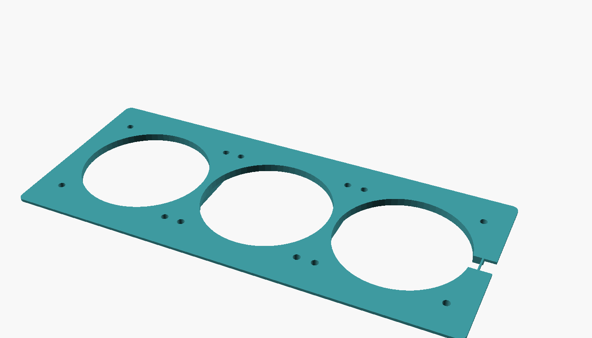

# Fan frame (3D print)

A plate that drops into the register opening under the grille. Its thin lip
rests on the floor or drywall around the hole, the grille sits on top as usual,
and the fans screw to the underside, blowing into the room.



## 1. Measure the vent

Take the grille off and measure the **hole** (the sheet-metal boot opening),
not the grille. Use mm if you can, to ±1 mm.

| # | What | Why |
|---|---|---|
| A | Opening **width**, inside edge to inside edge (the long side) | `opening_w` |
| B | Opening **height** (the short side) | `opening_h` |
| C | **Depth** from the floor surface down to anything in the way (boot bend, damper, screws) | Fans hang below the plate: 25 mm fans need about **30 mm**, 15 mm slim fans about 20 mm |
| D | How far the grille's flange overlaps the floor around the hole, on each side | The frame's lip (6 mm) must stay hidden under it |
| E | Is the opening square to the floor, or are there screw tabs/dampers sticking into it? | Tell me and I'll cut notches |
| F | Floor, wall or ceiling register? | Wall/ceiling needs screw holes instead of a resting lip |

Also note which end the fan wires should exit (the frame has a wire notch on
one short end).

## 2. Make the STLs

Send me the numbers and I'll update and export them, or run it yourself
(needs OpenSCAD):

```sh
./make_stl.sh <A width mm> <B height mm> <fan 80|60> <number of fans>
./make_stl.sh 254 101.6 80 3
```

This writes, in `stl/`:

| File | Use |
|---|---|
| `..._full.stl` | One piece. Needs a bed longer than the frame (~266 mm for a 10" vent): Bambu H2D, Prusa XL, Creality K1 Max and similar. |
| `..._half_a.stl` + `..._half_b.stl` + `..._tabs.stl` | Split version for normal 220–256 mm beds. The halves join on a rib with two small splice tabs underneath (4 × M3 × 10 screws + nuts, or glue). |

The script prints each part's size. Give the printer operator whichever set
fits their bed. The sizes below are the current files, for the nominal
4" × 10" (254 × 101.6 mm) opening; **re-export after measuring**.

| Set | Largest part |
|---|---|
| 3 × 80 mm, one piece | 266 × 114 mm |
| 3 × 80 mm, split | 174 × 114 mm |
| 4 × 60 mm, split | 195 × 114 mm |

`./make_stl.sh` refuses fan counts that don't fit (for example, 4 × 80 mm in
a 10" opening) and says why.

## 3. Print settings (for the printer operator)

- **Material: PETG or ASA. Not PLA.** Supply air in heating mode reaches
  50–60 °C, which softens PLA.
- Orientation: as exported (flat top face on the bed). **No supports needed.**
- 0.2 mm layers, 4 walls, 30 % infill, brim optional for ASA.
- After printing: check that an M3/M4 screw passes through the fan holes
  (4.3 mm for 80 mm fans, 3.6 mm for 60 mm), and dry-fit in the opening before
  mounting fans.

## 4. Install

1. Screw the fans to the underside, blowing **up/out** (label side facing down
   into the duct). Rubber grommets or foam washers under the screws cut
   vibration noise.
2. Run the fan leads (and the DS18B20 lead) through the wire notch to the
   controller board.
3. Run a strip of thin foam weatherstrip under the lip so it seals and doesn't
   rattle.
4. Drop it in and put the grille back on.
